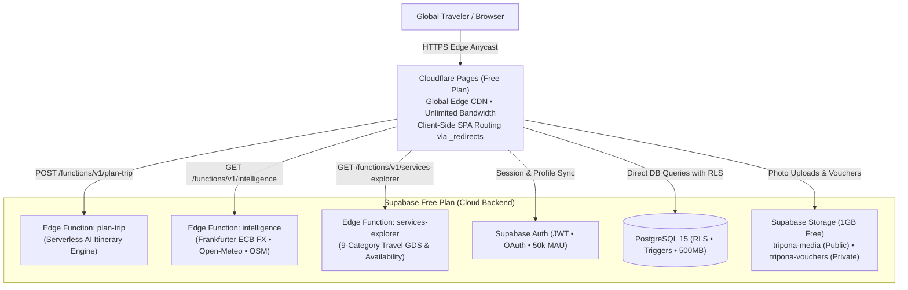

# TRIPONA — Complete Free Cloud Deployment Guide
## Architecture: Cloudflare Pages (Frontend) + Supabase (Database, Auth, Storage & Edge Functions)

This guide provides the complete, production-grade instructions to deploy **TRIPONA** to 100% free cloud infrastructure with zero ongoing server costs.

---

### Architecture Overview



---

## 1. Supabase Cloud Setup (Free Plan)

### Step 1.1: Create Project
1. Log in to [https://supabase.com](https://supabase.com) and create an organization / account.
2. Click **New project**:
   - **Name:** `tripona-cloud`
   - **Database Password:** Enter a strong password (save it in a password manager).
   - **Region:** Select the region closest to your primary user base (e.g., `Singapore`, `Frankfurt`, or `US East`).
   - **Plan:** Free ($0/month).
3. Once provisioned (~90 seconds), navigate to **Project Settings** → **API**:
   - Copy **Project URL** (e.g. `https://xyzcompany.supabase.co`).
   - Copy **Project API Key (anon/public)**.
   - Note the **Project Ref ID** (the unique string in your URL: `xyzcompany`).

---

### Step 1.2: Execute Master Database Migration
1. In the Supabase Dashboard, click on **SQL Editor** in the left sidebar.
2. Click **New query**.
3. Open [`supabase/migrations/20261114_master_tripona.sql`](file:///Users/joshuathomas/Documents/Antigravity%20project/TRIPONA/supabase/migrations/20261114_master_tripona.sql), copy its entire contents, paste them into the SQL editor, and click **Run**.
   - This single script creates:
     - 11 production tables with primary keys, foreign keys, and indexes: `profiles`, `destinations`, `world_cities`, `saved_destinations`, `trips`, `bookings`, `expenses`, `checklists`, `conversations`, `travel_intelligence_cache`, `api_cache`.
     - Row Level Security (RLS) on all 11 tables with zero public data leakage.
     - Auto-profile trigger (`on_auth_user_created`) and timestamp triggers.
     - Storage buckets: `tripona-media` (public) and `tripona-vouchers` (private).
4. Click **New query** again, paste the contents of [`supabase/seed.sql`](file:///Users/joshuathomas/Documents/Antigravity%20project/TRIPONA/supabase/seed.sql), and click **Run**.
   - Populates the 12 worldwide curated destinations.

---

### Step 1.3: Deploy Supabase Edge Functions (Serverless Backend)
All server-side secrets (like `GEMINI_API_KEY`) remain strictly on the backend.

1. Install Supabase CLI (if not already installed):
   ```bash
   npm install -g supabase
   ```
2. Log in and link your project:
   ```bash
   supabase login
   supabase link --project-ref <your-project-ref>
   ```
3. Set your secret environment variables in Supabase:
   ```bash
   supabase secrets set GEMINI_API_KEY=your_gemini_api_key_here
   ```
4. Deploy all 3 edge functions:
   ```bash
   supabase functions deploy plan-trip --no-verify-jwt
   supabase functions deploy intelligence --no-verify-jwt
   supabase functions deploy services-explorer --no-verify-jwt
   ```
   *Your live backend edge functions are now accessible at `https://<your-project-ref>.supabase.co/functions/v1/...`.*

---

## 2. Cloudflare Pages Deployment (Free Plan)

### Method A: Automated GitHub Continuous Deployment (Recommended)
1. Go to [https://dash.cloudflare.com](https://dash.cloudflare.com) and click **Workers & Pages**.
2. Click **Create Application** → **Pages** → **Connect to Git**.
3. Select your GitHub repository: `Joshclickss/TRIPONA`.
4. Configure Build Settings:
   - **Framework preset:** `Vite`
   - **Root directory:** `client`
   - **Build command:** `npm run build`
   - **Build output directory:** `dist`
5. Under **Environment variables (Advanced)**, add:
   - `VITE_SUPABASE_URL` = `https://<your-project-ref>.supabase.co`
   - `VITE_SUPABASE_ANON_KEY` = `<your-supabase-anon-public-key>`
6. Click **Save and Deploy**.
7. Cloudflare Pages automatically compiles the project in ~45 seconds and gives you a free live production URL:
   `https://tripona.pages.dev` (with instant global SSL/HTTPS).

### Method B: Deploy via Wrangler CLI
```bash
cd client
npm run build
npx wrangler pages deploy dist --project-name tripona
```

---

## 3. Client-Side SPA Routing & Asset Caching

Cloudflare Pages automatically reads the included file [`client/public/_redirects`](file:///Users/joshuathomas/Documents/Antigravity%20project/TRIPONA/client/public/_redirects):
```
/*    /index.html   200
```
- Ensures browser refreshes on any route (e.g. `/trips`, `/bookings`, `/intelligence`) work seamlessly with zero 404 errors.

---

## 4. Local Development & Testing Connected to Cloud

1. Create or update `client/.env`:
   ```bash
   VITE_SUPABASE_URL=https://<your-project-ref>.supabase.co
   VITE_SUPABASE_ANON_KEY=<your-supabase-anon-key>
   ```
2. Start the local client server:
   ```bash
   cd client
   npm run dev
   ```
3. Open [http://localhost:5173](http://localhost:5173). The application will automatically route authenticated operations and queries to your live cloud infrastructure.
